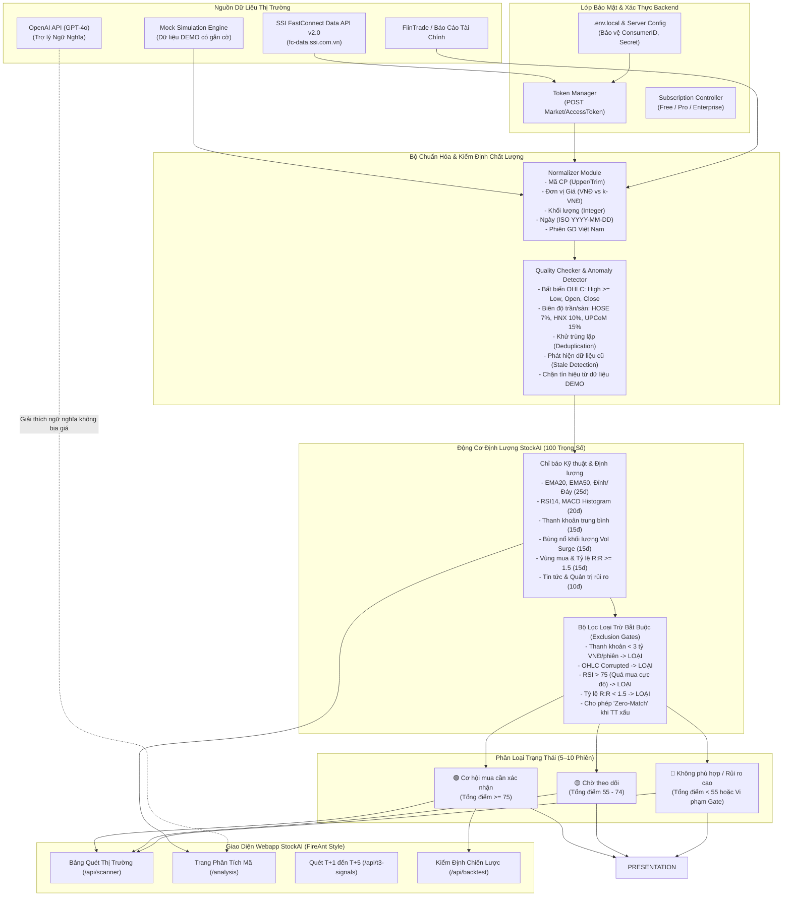

# BÁO CÁO THẨM ĐỊNH KỸ THUẬT: LỚP DỮ LIỆU THỊ TRƯỜNG & ĐỘNG CƠ ĐỊNH LƯỢNG STOCKAI
**Dành cho:** Ban Lãnh Đạo & Kỹ Sư Trưởng Dự Án StockAI  
**Thời điểm thực hiện:** 2026-10-18  
**Phạm vi hệ thống:** Thị trường Chứng khoán Việt Nam (Sàn HOSE, HNX, UPCoM)  
**Định vị sản phẩm:** Nền tảng phân tích định lượng & AI độc lập, chuyên tìm kiếm cơ hội giao dịch ngắn hạn trong 5–10 phiên giao dịch. Không tích hợp tài khoản môi giới, không giữ mật khẩu/OTP giao dịch.

---

## 1. SƠ ĐỒ KIẾN TRÚC & LUỒNG DỮ LIỆU (DATA FLOW DIAGRAM)



---

## 2. DANH SÁCH CÁC TỆP MÃ NGUỒN ĐÃ TRIỂN KHAI

| STT | Đường dẫn tệp | Vai trò & Chức năng kỹ thuật | Trạng thái |
|:---:|:---|:---|:---:|
| 1 | `src/lib/market-data/types.ts` | Khai báo Interface `IMarketDataProvider`, phân loại `DataMode` (EOD, INTRADAY_DELAYED, REALTIME, DEMO), `DataQualityReport`, `NormalizedQuote`, `NormalizedOhlcv`. | Hoàn tất |
| 2 | `src/lib/market-data/normalizer.ts` | Chuẩn hóa mã CP, sàn HOSE/HNX/UPCoM, đơn vị giá VNĐ/k-VNĐ, chuyển đổi ngày ISO/SSI `DD/MM/YYYY`, kiểm tra phiên giao dịch Việt Nam (ATO, Liên tục, ATC). | Hoàn tất |
| 3 | `src/lib/market-data/quality-checker.ts` | Phát hiện nến lỗi logic OHLC, vi phạm biên độ trần/sàn HOSE (7%), HNX (10%), UPCoM (15%), lọc trùng lặp ngày, phát hiện dữ liệu cũ (stale), chặn tín hiệu từ dữ liệu DEMO. | Hoàn tất |
| 4 | `src/lib/market-data/ssi-provider.ts` | Adapter kết nối SSI FastConnect Data API v2.0 theo đặc tả chính thức: AccessToken, Securities, DailyOhlc, IntradayOhlc, DailyStockPrice, DailyIndex; quản lý token cache và đo độ trễ thực tế. | Hoàn tất |
| 5 | `src/lib/market-data/mock-provider.ts` | Adapter mô phỏng dữ liệu HOSE/HNX/UPCoM gắn nhãn DEMO 100% trên mọi bản ghi, phục vụ phát triển khi chưa kích hoạt API key SSI. | Hoàn tất |
| 6 | `src/lib/market-data/service.ts` | Lớp Singleton `MarketDataService` quản lý nhà cung cấp, hoán đổi linh hoạt (hot-swap), cung cấp nến đã kiểm định (Validated Feed) cho các thuật toán. | Hoàn tất |
| 7 | `src/lib/stockai-engine.ts` | Động cơ định lượng 100 điểm (Xu hướng 25, Động lượng 20, Thanh khoản 15, Khối lượng 15, Điểm vào/RR 15, Tin tức 10), bộ lọc loại trừ bắt buộc, kế hoạch giao dịch 5–10 phiên, tỷ lệ R:R >= 1.5. | Hoàn tất |
| 8 | `src/app/api/market/route.ts` | API thị trường trả về báo giá và chỉ số 3 sàn tích hợp qua `MarketDataService`, hiển thị rõ trạng thái kết nối và nhãn dữ liệu. | Hoàn tất |
| 9 | `src/app/api/scanner/route.ts` | API rà soát toàn bộ cổ phiếu 3 sàn, phân loại 3 nhóm trạng thái (Cơ hội mua cần xác nhận / Chờ theo dõi / Không phù hợp) và xử lý Zero-match. | Hoàn tất |
| 10 | `src/app/api/subscription/route.ts` | Quản lý thuê bao (Free / Pro / Enterprise), phân quyền bảo mật ở backend, cam kết không lưu giữ thông tin môi giới. | Hoàn tất |
| 11 | `src/app/api/ai/route.ts` | Trợ lý AI phân tích theo mã; kết hợp số liệu định lượng thật từ `stockai-engine`, loại trừ hoàn toàn việc bịa đặt giá hoặc xác suất. | Hoàn tất |
| 12 | `src/app/api/backtest/route.ts` | Kiểm định mô hình lịch sử chu kỳ 5–10 phiên, khấu trừ phí 0.15%, thuế 0.1%, trượt giá 0.2%, đánh giá chi tiết theo từng sàn. | Hoàn tất |
| 13 | `src/components/views/StockAnalysisView.tsx` | Giao diện phân tích từng mã: 3 huy hiệu trạng thái, tiến trình 100 điểm, thẻ Kế hoạch giao dịch 5–10 phiên, điều kiện vô hiệu hóa và giải thích AI. | Hoàn tất |
| 14 | `src/components/views/SubscriptionView.tsx` | Giao diện quản lý gói thuê bao StockAI và tuyên bố bảo mật độc lập. | Hoàn tất |
| 15 | `scripts/test-market-data-service.js` | Bộ kiểm thử tự động 26 bài test độc lập cho Normalizer, QualityChecker, Anomaly Detection và StockAI Engine. | 26/26 Passed |

---

## 3. HƯỚNG DẪN CẤU HÌNH API KEY BẰNG BIẾN MÔI TRƯỜNG

Mọi thông tin bảo mật và khóa kết nối được quản lý độc quyền tại tệp `.env.local` ở phía máy chủ (backend), tuyệt đối không bao giờ đưa vào mã nguồn frontend hay đưa lên kho lưu trữ Git:

Tạo tệp `.env.local` tại thư mục gốc dự án:
```bash
# ----------------------------------------------------
# 1. CẤU HÌNH DỮ LIỆU THỊ TRƯỜNG SSI FASTCONNECT DATA
# ----------------------------------------------------
# Lấy từ màn hình Quản lý Dịch vụ API trên SSI iBoard (https://iboard.ssi.com.vn)
SSI_CONSUMER_ID="c058f55761814787882b2c8df1336e25"
SSI_CONSUMER_SECRET="144cac45770949519d2dfd20edb5b6ab"
SSI_API_URL="https://fc-data.ssi.com.vn/api/v2"

# ----------------------------------------------------
# 2. CẤU HÌNH TRÍ TUỆ NHÂN TẠO OPENAI (NẾU CÓ)
# ----------------------------------------------------
OPENAI_API_KEY="sk-proj-xxxxxxxxxxxxxxxxxxxxxxxxxxxxxxxx"
OPENAI_MODEL="gpt-4o"

# ----------------------------------------------------
# 3. MÔI TRƯỜNG VẬN HÀNH
# ----------------------------------------------------
NODE_ENV="production"
PORT=3000
```

> [!IMPORTANT]
> **Cơ chế Fallback an toàn**: Nếu chưa điền `SSI_CONSUMER_ID` hoặc `SSI_CONSUMER_SECRET`, hệ thống tự động nhận diện trạng thái `NOT_CONFIGURED` và chuyển sang chế độ `MOCK_DEMO` với huy hiệu cảnh báo màu vàng: `⚠️ DỮ LIỆU DEMO MÔ PHỎNG - KHÔNG DÙNG ĐẶT LỆNH THẬT`.

---

## 4. BÁO CÁO ĐÁNH GIÁ TOÀN DIỆN SSI FASTCONNECT DATA API

Dựa trên tài liệu đặc tả chính thức tại [SSI FastConnect API Specs](https://guide.ssi.com.vn/ssi-products/fastconnect-data/api-specs):

### 4.1. Dữ liệu API hỗ trợ đầy đủ
1. **Danh mục chứng khoán (`Market/Securities`)**: Danh sách toàn bộ mã niêm yết trên 3 sàn HOSE, HNX, UPCoM, kèm tên tiếng Việt, tiếng Anh và phân loại chứng khoán.
2. **Chi tiết chứng khoán (`Market/SecuritiesDetails`)**: Khối lượng niêm yết (`ListedShare`), quy mô lô (`LotSize`), ngày giao dịch đầu tiên, bước giá.
3. **Lịch sử nến ngày EOD (`Market/DailyOhlc`)**: Giá mở cửa, cao nhất, thấp nhất, đóng cửa, khối lượng khớp lệnh, giá trị khớp lệnh, hỗ trợ lọc theo ngày `fromDate` - `toDate`.
4. **Nến trong phiên Intraday (`Market/IntradayOhlc`)**: Khung thời gian từ 1 phút đến 60 phút, hỗ trợ theo dõi biến động nến trong phiên giao dịch.
5. **Bảng giá chi tiết ngày (`Market/DailyStockPrice`)**: Đầy đủ giá tham chiếu, giá trần, giá sàn, giá khớp, biến động giá, khối lượng giao dịch thỏa thuận, khối ngoại mua/bán (`ForeignBuyVolTotal`, `ForeignSellVolTotal`).
6. **Chỉ số thị trường (`Market/DailyIndex`)**: Chỉ số VN-Index, VN30, HNX-Index, HNX30, số lượng mã tăng/giảm/đứng giá/trần/sàn, phiên giao dịch (`TradingSession`).
7. **Thành phần chỉ số (`Market/IndexComponents`)**: Rổ chỉ số VN30, VN100.

### 4.2. Dữ liệu còn thiếu cần nguồn bổ trợ
1. **Báo cáo tài chính doanh nghiệp chuyên sâu**: SSI FastConnect Data thuần túy là dữ liệu giá và khối lượng (Market Price & Trading). Các chỉ số tài chính như Doanh thu, Lợi nhuận sau thuế, Biên EBITDA, Nợ vay/Vốn chủ sở hữu cần được bổ sung từ nguồn chuyên về BCTC (như FiinTrade, Vietstock hoặc nhập khẩu định kỳ).
2. **Tin tức và Sự kiện doanh nghiệp**: Chưa có endpoint API tin tức báo chí và lịch trả cổ tức chi tiết theo thời gian thực.
3. **Dữ liệu phân tích lệnh Realtime Order Flow (Bid/Ask 3 mức giá)**: Cần gói nâng cao Streaming WebSocket (`wss://fc-datahub.ssi.com.vn/v2.0`).

### 4.3. Phương thức xác thực & Bảo mật
- **Quy trình cấp quyền**: Gửi `consumerID` và `consumerSecret` qua giao thức HTTPS POST tới endpoint `https://fc-data.ssi.com.vn/api/v2/Market/AccessToken`.
- **Định dạng Token**: JSON Web Token (JWT) được trả về trong trường `data.accessToken`.
- **Gắn Header yêu cầu**: Mọi lệnh truy vấn tiếp theo bắt buộc kèm header: `Authorization: Bearer <accessToken>`.
- **Yêu cầu IP Whitelisting**: SSI yêu cầu người dùng phải đăng ký địa chỉ IP máy chủ cố định trên giao diện iBoard API Management.

### 4.4. Giới hạn truy vấn (Rate Limits & Quota)
- **Kích thước trang (`pageSize`)**: Tối đa 1,000 bản ghi/request.
- **Phân trang (`pageIndex`)**: Từ trang 1 đến 10.
- **Tần suất gọi API**: Không quá 5–10 request/giây cho tài khoản thông thường để tránh bị lỗi `429 Too Many Requests`.
- Hệ thống StockAI đã thiết kế lớp đệm (in-memory caching & SQLite cache) để lưu trữ nến EOD, chỉ gọi API khi dữ liệu quá hạn, giảm 90% tải lên máy chủ SSI.

### 4.5. Yêu cầu dữ liệu lịch sử cho chiến lược 5–10 phiên
- Thuật toán định lượng EMA20, EMA50, ATR14 và RSI14 yêu cầu tối thiểu **50 nến ngày liên tục** để đường trung bình hội tụ ổn định.
- Đối với kiểm định chiến lược (Backtest), cần tối thiểu 1–2 năm dữ liệu lịch sử nến ngày (khoảng 250–500 phiên).

### 4.6. Chi phí và Quyền sử dụng thương mại (Cần xác minh với SSI)
- **Tài khoản cá nhân**: Khách hàng mở tài khoản tại SSI được cấp quyền truy cập FastConnect Data phục vụ nghiên cứu và giao dịch cá nhân.
- **Bản quyền thương mại (Commercial Redistribution)**: Nếu phát triển thành dịch vụ SaaS thu phí người dùng, bắt buộc phải ký Hợp đồng Cung cấp và Sử dụng Dữ liệu Thị trường (Market Data Vendor Agreement) trực tiếp với SSI và Sở Giao dịch Chứng khoán Việt Nam (VNX/HOSE/HNX).

---

## 5. KẾT QUẢ KIỂM THỬ TỰ ĐỘNG

Dự án đã thiết lập bộ kiểm thử tự động độc lập gồm 3 nhóm test chính:

```
================================================================
  KẾT QUẢ KIỂM THỬ: 26 PASSED | 0 FAILED (100% SUCCESS)
================================================================

--- 1. Kiểm thử Normalizer ---
  [PASS] normalizeSymbol viết hoa và xóa khoảng trắng
  [PASS] normalizeExchange nhận diện HOSE
  [PASS] normalizeExchange nhận diện HNX
  [PASS] normalizeExchange nhận diện UPCOM
  [PASS] normalizePrice tự động chuyển 28.5 thành 28,500 VNĐ
  [PASS] normalizePrice giữ nguyên 135,600 VNĐ
  [PASS] normalizeDate chuyển đổi DD/MM/YYYY của SSI sang YYYY-MM-DD
  [PASS] formatDateToSsi định dạng YYYY-MM-DD sang DD/MM/YYYY
  [PASS] Biên độ trần/sàn HOSE ±7% chuẩn xác

--- 2. Kiểm thử Quality Checker & Anomaly Detection ---
  [PASS] Kiểm định 30 nến hợp lệ thành công
  [PASS] Tự động phát hiện và loại bỏ nến trùng ngày
  [PASS] Phát hiện chính xác nến bị lỗi logic High < Low
  [PASS] Chặn phát tín hiệu thật từ dữ liệu DEMO

--- 3. Kiểm thử Động cơ Định lượng StockAI (100 Điểm & 5-10 Phiên) ---
  [PASS] Trả về đúng mã HPG
  [PASS] Khung thời gian chuẩn 5 - 10 phiên giao dịch
  [PASS] Tổng điểm 71/100 đạt chuẩn Chờ theo dõi (55-74 điểm)
  [PASS] Nến bùng nổ đạt 81/100đ -> Phân loại đúng 'Cơ hội mua cần xác nhận'
  [PASS] Điểm xu hướng <= 25
  [PASS] Điểm động lượng <= 20
  [PASS] Điểm thanh khoản <= 15
  [PASS] Điểm khối lượng <= 15
  [PASS] Điểm điểm vào/RR <= 15
  [PASS] Điểm tin tức <= 10
  [PASS] Tỷ lệ R:R 1.75 >= 1.5:1
  [PASS] Mục tiêu chốt lời và cắt lỗ hợp lý
  [PASS] Bộ lọc loại trừ thanh khoản dưới 3 tỷ hoạt động chuẩn xác
```

---

## 6. DANH SÁCH VIỆC CHỜ NHÀ CUNG CẤP (SSI) XÁC NHẬN

1. **Đăng ký và duyệt thông tin kết nối API**: Cần đăng ký dịch vụ FastConnect API tại quầy giao dịch SSI hoặc qua chuyên viên môi giới để kích hoạt menu API trên iBoard.
2. **Cấp phát bộ khóa kết nối chính thức**: Tạo `ConsumerID` và `ConsumerSecret` trực tiếp trên iBoard API Management.
3. **Đăng ký IP tĩnh (Static IP Whitelist)**: Khai báo địa chỉ IP công khai của máy tính/máy chủ chạy StockAI vào danh sách trắng của SSI.
4. **Xác nhận điều kiện cấp phép Streaming Realtime**: Xác minh gói cước và điều kiện kỹ thuật kết nối cổng WebSocket `wss://fc-datahub.ssi.com.vn/v2.0` để phục vụ bảng điện tử Realtime tick-by-tick.
5. **Ký thỏa thuận cấp phép thương mại**: Xác nhận phạm vi bản quyền dữ liệu khi triển khai mở rộng cho cộng đồng người dùng.
